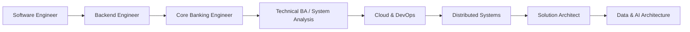

<div align="center">

# 👋 Hi, I'm Truong Minh Khoa

### Software Engineer → Solution Architect

**Core Banking • Backend Engineering • Full-Stack • Cloud • DevOps • Data • AI**

[](https://www.linkedin.com/in/minh-khoa-tech/)
[](https://github.com/khoatmhcm1999vn)
[](https://github.com/khoatmhcm1999vn)

</div>

---

## 🚀 About Me

I'm a **Software Engineer** with a strong interest in designing and building
enterprise systems across **backend engineering, Core Banking, databases,
cloud infrastructure, DevOps, data platforms, and AI**.

My professional journey is evolving from:

```text
Software Engineer
      ↓
Backend / Enterprise Systems
      ↓
Core Banking & Data
      ↓
Cloud & DevOps
      ↓
Distributed Systems
      ↓
Solution Architecture
      ↓
Data & AI Engineering
```

I enjoy understanding a system **end-to-end**:

> **Business Requirements → Architecture → Backend → Database → Frontend → Infrastructure → Data → AI**

My long-term goal is to become a **Solution Architect** capable of bridging
business requirements with scalable software, cloud infrastructure,
data platforms, and AI solutions.

---

## 💼 Professional Focus

🏦 **Core Banking & Financial Systems**
- Core Banking workflows
- Oracle SQL / PL/SQL
- GL & accounting flows
- CASA / Deposits / Loans
- Collateral & Limit Management
- EOD processing
- Regulatory & management reporting
- Data investigation & production issue analysis

⚙️ **Backend & Enterprise Engineering**
- Java
- Spring Boot
- RESTful APIs
- Microservices
- WebSocket
- Maven
- API integration
- Performance optimization

☁️ **Cloud & DevOps**
- Docker
- Docker Compose
- Git
- GitHub Actions / CI/CD
- Linux
- Vercel
- Supabase
- Cloud-native architecture concepts

📊 **Data & Architecture**
- Oracle
- PostgreSQL
- Relational database design
- SQL optimization
- System Design
- Solution Architecture
- Event-driven architecture
- Distributed systems

---

# 🛠️ Tech Stack

## 👨‍💻 Languages

<p>
  
</p>

**Primary focus:** Java • SQL / PL/SQL • JavaScript  
**Also experienced / explored:** Python • C# • C / C++

---

## ⚙️ Backend

<p>
  
</p>

`Spring Boot` • `REST APIs` • `Microservices` • `WebSocket` • `Maven`

---

## 🎨 Frontend

<p>
  
</p>

`React` • `HTML5` • `CSS3` • `JavaScript` • `TypeScript`

---

## 🗄️ Databases

<p>
  
</p>

### Hands-on / Professional Focus

`Oracle Database` • `SQL` • `PL/SQL` • `PostgreSQL`

### Expanding Into

`MongoDB` • `Redis` • `NoSQL Architecture`

---

## ☁️ DevOps & Cloud

<p>
  
</p>

`Docker` • `Docker Compose` • `Git` • `GitHub` • `CI/CD`
• `Linux` • `Vercel` • `Supabase`

---

## 📡 Distributed Systems & Big Data — Learning Roadmap

<p>
  
</p>

Currently deepening my knowledge in:

- 📨 Apache Kafka
- ⚡ Apache Spark
- 🍃 MongoDB / NoSQL
- 🔄 Event-Driven Architecture
- 🧩 Distributed Systems
- 📦 Message Brokers
- 📊 Big Data Processing
- 🏗️ Scalable System Design

> I prefer to learn technologies by understanding **why a system needs them**
> before adding them to an architecture.

---

## 🤖 AI Engineering — Exploring

<p>
  
</p>

I'm exploring how AI can be integrated into enterprise software through:

- AI-assisted software engineering
- LLM-powered applications
- RAG architectures
- AI Agents
- Data Engineering for AI
- Machine Learning fundamentals
- Enterprise AI integration

I also have an academic project applying **K-Means clustering** to
customer segmentation.

---

# 🌟 Featured Projects

## 📱 VivaCon — Social Network Platform

[](https://github.com/khoatmhcm1999vn/viva-spring-reactjs)

An Instagram-style social networking application built as a full-stack
engineering playground for learning modern software architecture.

### Architecture

```text
                ┌───────────────────┐
                │       React       │
                │      Frontend     │
                └─────────┬─────────┘
                          │
                     REST / WS
                          │
                ┌─────────▼─────────┐
                │    Spring Boot    │
                │      Backend      │
                └─────────┬─────────┘
                          │
                ┌─────────▼─────────┐
                │    PostgreSQL     │
                └───────────────────┘

                       +
                Docker / CI/CD
```

### Technologies

`Java` • `Spring Boot` • `React` • `REST API` • `WebSocket`
• `PostgreSQL` • `Docker` • `Docker Compose`

### Infrastructure Direction

```text
React
  ↓
Vercel

Spring Boot
  ↓
Docker
  ↓
Ubuntu Server

PostgreSQL
  ↓
Supabase

Internet Exposure
  ↓
Cloudflare Tunnel

Automation
  ↓
GitHub Actions
```

🎯 **Architecture journey:** Monolith first → learn operational fundamentals
→ evolve toward scalable architecture when justified.

---

## 📚 EBook Shop

[](https://github.com/khoatmhcm1999vn/EBookShopWebsite)

A web-based bookstore project developed as part of my journey into
full-stack and Java web development.

---

## 💻 ELaptop Shop

[](https://github.com/khoatmhcm1999vn/ELaptopShopWebsite)

An e-commerce project focused on web application development,
database integration, and application structure.

---

## 🧠 Customer Segmentation with K-Means

[](https://github.com/khoatmhcm1999vn/Clustering-customer-segmentation-by-the-K-mean-algorithm)

Academic machine-learning project exploring:

`K-Means` • `Clustering` • `Customer Segmentation` • `Data Analysis`

---

# 🏗️ Architecture Mindset

I'm increasingly interested in the decisions **behind the code**:

```text
                         BUSINESS
                            │
                            ▼
                    REQUIREMENTS
                            │
                            ▼
                  SOLUTION ARCHITECTURE
                            │
             ┌──────────────┼──────────────┐
             ▼              ▼              ▼
          Backend        Frontend         Data
             │              │              │
             └──────────────┼──────────────┘
                            ▼
                      Integration
                            │
                            ▼
                   Cloud / DevOps
                            │
                            ▼
                     Observability
                            │
                            ▼
                       Data & AI
```

Questions I'm interested in:

- When should a system stay **monolithic**?
- When does **microservices architecture** actually make sense?
- Sync vs async communication?
- REST vs event-driven integration?
- When should we introduce Kafka?
- SQL vs NoSQL?
- How do we design systems for scalability and reliability?
- How should DevOps influence application architecture?
- Where can AI genuinely improve enterprise systems?

---

# 🌱 What I'm Currently Learning

```yaml
architecture:
  - Solution Architecture
  - System Design
  - Design Patterns
  - Microservices
  - Event-Driven Architecture
  - Distributed Systems

devops:
  - Docker
  - CI/CD
  - Linux
  - Cloud Computing
  - Infrastructure Architecture
  - Observability

data:
  - Oracle
  - PostgreSQL
  - MongoDB
  - Redis
  - Apache Kafka
  - Apache Spark

ai:
  - AI Engineering
  - LLM Applications
  - RAG
  - AI Agents
  - Machine Learning
```

---

# 🎯 Career Direction



My goal is not simply to collect technologies.

I want to understand:

> **How software, infrastructure, data, business, and AI work together as one system.**

---

# 📊 GitHub

<div align="center">


</div>

---

# 🤝 Let's Connect

I'm always interested in discussing:

`Backend Engineering`
•
`Core Banking`
•
`Solution Architecture`
•
`System Design`
•
`DevOps`
•
`Cloud`
•
`Data Engineering`
•
`AI Engineering`

<p align="center">

<a href="https://www.linkedin.com/in/minh-khoa-tech/">
  
</a>

<a href="https://github.com/khoatmhcm1999vn">
  
</a>

</p>

---

<div align="center">

### 💡 Build. Understand. Architect. Scale.

**From writing code → to understanding systems → to designing architecture.**

</div>
